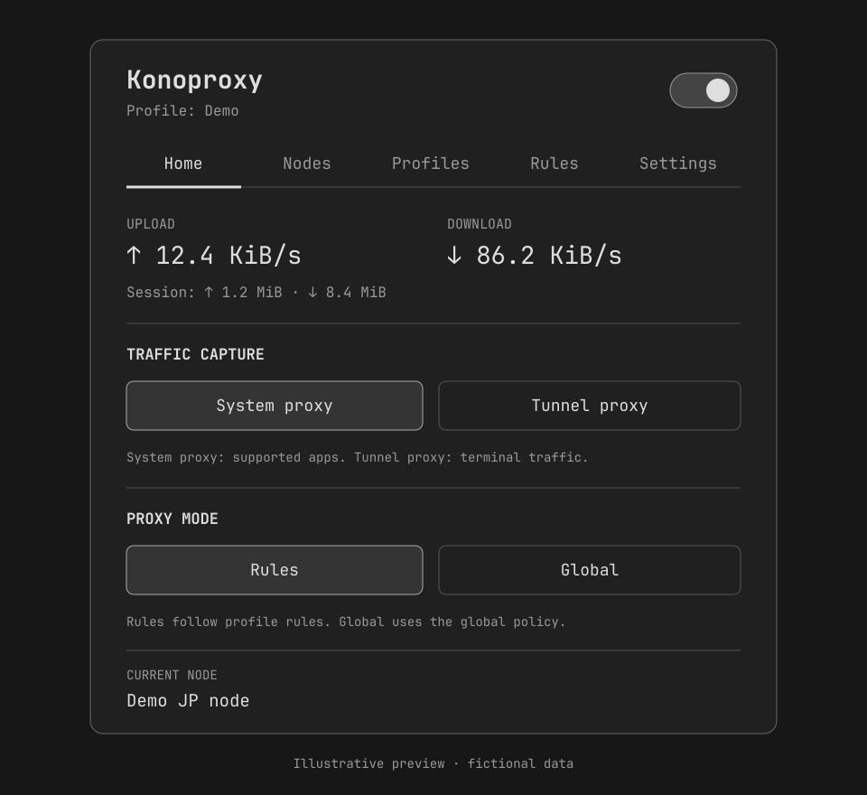

# Konoproxy

Native proxy controls, without a separate dashboard. Part of
[Konochi](https://github.com/xvvhang/konochi), a collection of native Omarchy plugins.

A lightweight, English-only Omarchy shell plugin with a managed Mihomo core.
No separate proxy GUI, web dashboard, Node.js runtime or user-managed Mihomo
installation is required. Chinese documentation is available in
[README.zh-CN.md](README.zh-CN.md).

## Preview

[](preview.png)

Illustrative preview with fictional data; the live appearance follows your theme.

## Features

- Explicit core installation consent and administrator authorization.
- Dedicated service with optional boot startup; no automatic traffic capture.
- Exclusive traffic capture: System proxy or Tunnel proxy, with core power control.
- Separate Rules and Global proxy policies.
- HTTPS Mihomo / Clash.Meta YAML subscriptions and local YAML profiles.
- Multiple profiles, rename, activate, manual updates and scheduled refresh.
- Custom text rules, local rule-file import and remote YAML/text/MRS rule sets.
- Profile-grouped node lists, offline selection and automatic per-opening latency checks.
- Automatic exit-region lookup with private persistent region-code caching.
- Small native dashboard with sampled rates and session traffic totals.
- Candidate validation, controller-apply rollback and retained profile sources.
- Uninstall confirmation with optional managed-core removal.

## Installation

Requires **Omarchy Quattro** and system Python 3.11+. See the detailed
[requirements](#requirements-and-installed-components) below.

```sh
omarchy plugin add https://github.com/xvvhang/omarchy-konoproxy-plugin --enable
```

Enabling the plugin does not install the core or enable traffic capture.
Core setup is a separate, explicitly authorized step in Settings.

### Local development

Place this directory at `~/.config/omarchy/plugins/konochi.konoproxy`, then run:

```sh
omarchy plugin validate ~/.config/omarchy/plugins/konochi.konoproxy
omarchy-shell shell rescanPlugins
omarchy plugin enable konochi.konoproxy
omarchy bar move konochi.konoproxy --section right
```

Open the cat icon and choose **Set up Mihomo**. Review the installation
notice and the separate boot-start option, then choose **Agree and install**.
The setup uses `pkexec` to install a fixed, checksum-pinned release and its
service. Until setup is explicitly accepted, the plugin installs nothing and
does not change network settings.

The initial core is direct-only, binds to loopback and does not enable TUN or
the desktop proxy. Import and activate a profile before enabling capture.
Setup offers an explicit **Allow password-free start, stop and restart** option.
When selected, installation adds a narrow polkit rule for the dedicated unit,
only for its owner's active local session. It does not authorize other units,
unit-file changes or arbitrary commands. Installation and removal still require
administrator authorization. Other processes of the same account in an active
local session can also control that specific unit.

Existing installations can choose **Settings → Authorize service controls...**
and accept a one-time administrator prompt. This installs the rule and updates
the root-owned helper without restarting the core. Until accepted, authenticated
legacy controls remain in use. No system policy is silently installed on plugin
enable or update.

## Requirements and installed components

- Omarchy Quattro, Quickshell, Qt Quick Controls Basic and system Python 3.11+.
- Standard Arch utilities: `pacman`, `systemd`, `iproute2`, `polkit`, coreutils (`timeout`) and CA roots.
- Setup installs `python-yaml` through pacman if needed. PyYAML is not needed
  just to show the initial setup screen.
- Optional desktop proxy: `gsettings` and the GNOME proxy schemas. Programs
  must honor these settings; the plugin does not edit shell startup files or
  claim to retroactively modify terminal environments.
- Supported core architectures: x86_64 (compatible build) and aarch64.
- A graphical polkit authentication agent must be running.

Core version and compressed-asset SHA-256 pins are recorded in `release.json`
and the privileged installer. Downloading is from the official MetaCubeX/mihomo
GitHub release only. A checksum pin verifies that exact asset, not an independent
signature. No mirror or `curl | sh` installer is used.

The current implementation supports one managed owner per machine. It does not
replace an existing managed installation or silently upgrade its core. Updating
the pinned core requires a reviewed plugin release and explicit reinstallation.
The core's own upstream license applies; the plugin license does not relicense
Mihomo. See [Mihomo](https://github.com/MetaCubeX/mihomo).

## Just My Socks

Use the service's **Subscription → Mihomo / Clash.Meta YAML** URL. Paste it in
**Profiles**, enter a name, import it, and activate the resulting profile.

JMS officially provides compatible Shadowsocks, VMess and VLESS Reality nodes,
a **JMS** manual selector and a **JMS Auto** latency-based selector. Konoproxy
preserves these groups. Clicking a node selects it directly. URLTest and Fallback
groups support manual overrides internally; the node list does not expose separate
policy-group controls. LoadBalance groups remain automatic. Legacy Base64 subscriptions are rejected with
guidance rather than sent to an external conversion website.

Reference: [JMS official Clash support announcement](https://justmysocks.net/members/index.php?rp=/announcements/34/Clash-support-added.html).

## System proxy, TUN and routing policy

**System proxy** writes the desktop's HTTP, HTTPS and SOCKS proxy settings.
Only applications that honor those settings use it. Terminal tools often do not.
Previous values are saved before modification and restored only when the
current value still matches the plugin's own value.

**TUN** sends traffic through a virtual interface and managed routing rules.
It can capture new connections from existing terminals without proxy environment
variables. Coverage depends on routing, exclusions, IP-family support and other
network software; an application's own encrypted DNS is not magically converted
into ordinary DNS. UDP support also depends on the outbound node.

**Traffic capture** is a radio group: **System proxy / Tunnel proxy**.
Changing capture disables the previous path before enabling the new one and
attempts rollback on failure. There is no Off option in this group; stop the core
with the header switch. Setup still starts without capture; choose a capture
option explicitly. The backend retains its safe off state for setup and recovery.

**Proxy mode** is a separate radio group: **Rules / Global**. It controls what
Mihomo does with captured requests. There is no Direct-mode button; direct
routing is still available through profile rules and DIRECT nodes. Use
the header's on/off switch to stop the service and restore plugin-owned desktop proxy settings.

Unknown TUN/WireGuard interfaces still block capture with their names in the error.
Verified split-routing Tailscale can coexist: its policy rules must precede
Konoproxy's, no exit node or default routes may be configured, and its overlay
IPv4/IPv6 ranges bypass capture. Tailscale preferences and routes are read only;
the plugin never stops Tailscale. Existing managed interfaces require confirmation
from the authenticated controller; stale interfaces/rules are reported, not deleted.
More complex WireGuard, policy-routing, container and firewall combinations need
manual review. IPv6 routing and DNS must be tested on the actual target network.
TUN does not promise to preserve already established connections across a
capture-mode change. LAN hosts are not automatically excluded from TUN routing;
add appropriate direct rules when needed.

## Rules and profiles

Source YAML and generated runtime YAML are separate. Managed compilation keeps
proxies, groups, HTTP providers, rules and hosts. It deliberately does not inherit
subscription listeners, controllers, TUN settings, arbitrary UI downloads or DNS
configuration. Provider cache paths are rewritten inside the private data
directory. Only HTTPS-backed providers are accepted. This is a managed client,
not a general-purpose raw Mihomo configuration editor.

Custom remote rule sets precede custom text rules, which precede subscription
rules. Text rules use one native Clash rule per line, without a `rules:` wrapper.
They can reference existing policy groups, `DIRECT` or `REJECT`. MRS supports
domain and ipcidr behavior, not classical behavior. Candidate validation rejects
invalid targets and syntax before replacing the runtime configuration.

Automatic refresh runs while the enabled plugin backend is alive, at a selected
6/12/24-hour interval. It is not a separate always-running update daemon. Failed
updates keep previous sources and runtime; failures retry on the next interval.

## Panel interaction

The fixed header uses a native on/off switch. Real tab labels use an underline,
not selected-option boxes. Controls use the shell's foreground color and
`Style.cornerRadius`, rather than a separate accent palette or hardcoded radii.
Home omits the connection-status hero and presents plain traffic stats, section
headers, separators and native power-panel mode options, without tinted cards.
Bordered option controls represent persistent selections; executable commands
use unframed text links instead. Profiles use the same plain sections and
selectable rows as Nodes: click the name area to activate it; its checkmark reflects the
saved active profile. **Edit...**, **Refresh** and **Delete...** are separate
text actions inside the same profile outline, not nested in the selection control.
Delete requires inline confirmation and
cannot remove the active profile.

**Add profile** and **Edit...** open a shared, card-free form in place of the
list, with persistent field labels and native shell text inputs. Editing can
rename a profile or replace its URL/local YAML without creating a duplicate;
leave the source blank to retain it. Stored subscription URLs are never sent to
the panel. Replacing a source preserves the profile ID, custom rules and active
status, and validates/applies transactionally. Success closes the form; failure
retains the entered fields. Cancel or closing the panel discards the draft.

Settings → **Bar content** has two independent, persistent switches: selected
node region, then upload / download speed. The bar uses the same order, with
region to the left of speed. Both default to off (icon only).
Region uses verified node-region results, with
`--` for unknown; enabling its display does not start a lookup. Speed display
samples the local controller every two seconds even with the panel closed;
it does not start node probes or change capture. Disabling it restores normal
5-second open / 30-second closed status polling. Icon-only sizing uses the
native optical slot; optional labels use actual text widths instead of oversized
sample placeholders. The open-panel underline follows content width without
outer padding; icon-only mode uses the shell's native indicator sizing.
Legacy region-display preferences are preserved; obsolete capture/policy label
options are ignored. The bar shows an original Clash-inspired, always-filled cat
silhouette. Active TUN ruffles its fur; other states have a smooth contour.
R (Rules) or G (Global) is cut out at the center of its chest, not placed beside
the icon. No capture or a stopped core dims the cat. Both silhouettes share the
same fixed optical slot; changing modes cannot change its dimensions.
Core start/stop/restart does not insert a progress banner; stable helper text and
single-line node summaries avoid shifting panel contents when power changes.
Power, capture and policy controls show an in-place spinner while changing.
The power spinner is centered inside the native switch's moving knob, sized to
fit it and colored for contrast; the switch track remains at normal opacity.
They remain busy until a subsequent controller snapshot confirms the target,
not merely until the command returns. Failure clears the transition and retains
actual state; a 15-second post-command confirmation timeout reports uncertainty
rather than leaving the control stuck.

Node, profile, capture and policy switches omit progress/success banners;
failures remain visible. Rules uses plain Custom Rules, Import Rules and Remote
Rule Sets sections, with an outlined but unfilled editor. Settings combines core
controls and uninstall in one section, keeping longer safety notes inside their
confirmation forms. It uses plain section headers and separators,
with **Off / 6 hours / 12 hours / 24 hours** radio buttons for subscription
refresh rather than a dropdown. The selected value follows saved backend state.
The generic "Operation completed" message is omitted for every action; specific
results and errors are still shown.
Nodes use plain native section headers and separators without group cards or
search. Opening the panel starts latency requests before region lookup; pending
nodes display a rotating monochrome icon, replaced immediately by the measured
latency or Unavailable without waiting for the region request to finish.

Nodes appear once per profile, not repeatedly in every proxy policy group.
Sections do not collapse. Each has a list capped at 300 scaled pixels, with
independent scrolling like the native Bluetooth panel. Sources and cached proxy
providers are read locally, so stopping the core does not hide the node lists.
Providers without a local cache are reported explicitly, not invented.

Clicking a node activates its profile and chooses a reachable selector path.
While stopped, the selection is saved and applied on the next start. Pending
selections on automatic startup are restored while the enabled backend is alive.
Node order follows the profile. There are no sorting, Region, Auto or Test controls
in the node list. Region and latency checks run once per panel opening, including
when the main service is stopped or a profile is inactive. Switching tabs and
normal status updates do not restart them. Identical node configurations share
one probe; changed credentials or server settings have a different probe identity.
Results do not collide just because two profiles use the same node name.

### Exit regions, not guesses from names

Mihomo's proxy API does not provide a standard country field. JMS names can be
opaque, and geolocating a server's DNS/ingress address does not necessarily identify
its exit location. The UI therefore does not guess countries from node names.

Opening the panel automatically starts up to two temporary, unprivileged Mihomo
instances to check configured nodes. Each node instance is reused for an HTTPS
request to `https://www.cloudflare.com/cdn-cgi/trace` and a latency request to
`https://www.gstatic.com/generate_204`. The `loc`
field describes the requesting exit IP's country, not the `colo` data-center
location. TLS is validated. The active service, selection and capture settings
are not changed, and no direct fallback is configured in the probe.
Each child has a 40-second watchdog even if the panel backend exits unexpectedly.
Checks run in a separate two-worker pool and do not make the UI's service,
profile or node-selection controls busy. Closing cancels queued checks, stops
further requests between probe stages, and ignores late session results.

The UI shows codes such as **US**, **UK** and **JP** (`GB` is displayed as `UK`),
or **--** when unverified. Only codes, timestamps and configuration fingerprints
are cached in the private `regions.json`; probe configurations are 0600 temporary
files and are cleaned up. Changed node settings invalidate the cache; entries
older than seven days are marked for refresh. Failed probes retain previous
results. Closing the panel does not erase region codes.

Cloudflare and Google observe requests from the node's exit IP. Opening the panel
now triggers these checks without a per-run confirmation. IP geolocation is an estimate, not
proof of physical location, and the debug endpoint's format is not guaranteed.
Unreachable nodes, missing location fields and chained `dialer-proxy` nodes remain
unverified rather than silently testing a different route.

References: [Mihomo API](https://wiki.metacubex.one/en/api/),
[Cloudflare endpoint](https://developers.cloudflare.com/fundamentals/reference/cdn-cgi-endpoint/),
[IP geolocation limitations](https://developers.cloudflare.com/network/ip-geolocation/).

Latency checks issue small HTTPS probes through each specific node, not the
currently selected global route. They are not ICMP ping or bandwidth tests.
Region failure does not prevent the independent latency request from running.
Displayed results live only in the panel session and clear when the panel closes.
Late results from a closed session are ignored, even if the panel has reopened.
The core's own health-check history is not deleted or reused as panel-test results.

## Privilege boundary and persistence

```text
~/.config/omarchy/plugins/konochi.konoproxy/  Unprivileged plugin source
$XDG_DATA_HOME/konoproxy/                    Private profiles and runtime state
  state.json                               Names, URLs, settings and local rules
  profiles/<id>.yaml                        Original profile sources
  runtime.yaml                             Managed active configuration
  last-good.yaml                           Previous runtime after a successful apply
  controller-secret                        Random loopback API credential
  regions.json                             Verified exit-country code cache
  view-cache.json                          Last observed node selection
  system-proxy.json                        Previous desktop proxy settings, if enabled
/usr/local/lib/konoproxy/                   Root-owned core, helper and owner metadata
/etc/systemd/system/konoproxy-<uid>.service  Dedicated system unit
/etc/polkit-1/rules.d/49-konoproxy-<uid>.rules  Optional narrowly scoped control rule
```

The data directory defaults to `~/.local/share/konoproxy` (0700). Sensitive files
are created with 0600. URLs and core output are not copied into normal UI logs
or `shell.json`; node names and user-supplied profile content remain unchanged.
Data paths must be non-symlink paths inside the user's home without whitespace
or special characters for safe systemd unit generation.

The core runs as the requesting user, **not root**, with bounded
`CAP_NET_ADMIN` and `CAP_NET_RAW` capabilities. The executable, helper and unit
are root-owned. No capability is added to a user-writable executable. The service
can still modify host networking: this is privileged network software, not a
sandbox for malicious subscriptions or hostile local users.

Mihomo exposes its authenticated controller only on `127.0.0.1:17990`; applications
use `127.0.0.1:17890` or TUN. Other controllers are not discovered or adopted.
The managed TUN is `kp<uid>`, with dedicated table `200000 + uid` and initial
rule priority `12000 + (uid % 1000)` (plus its following ten slots); reserve these
for Konoproxy. This is after Tailscale's policy rules but before Linux's main
table rule at 32766; the old priority above 210000 incorrectly ran after main.
The new priority applies on the next configuration apply, not by modifying an
already running service during a shell reload. Stop/crash cleanup
targets only that interface and table, never the host's main table or firewall.

## Uninstall

Use **Settings → Uninstall...**:

- **No, keep core** removes the plugin only. The core/service and active proxy
  can continue running; review this warning before choosing it.
- **Yes, remove both** restores owned desktop proxy values, stops and disables
  the dedicated service, cleans managed routes, removes the root-owned core
  and helper plus its optional authorization rule, then removes the plugin
  through a detached user unit.
- **Cancel** changes nothing. Authorization failure retains the plugin.

Profile data is always retained in this version. `python-yaml` is left installed
because it may be used by other software. Uninstall never removes another
application's core, config or service.

**Omarchy currently has no plugin uninstall hook.** Directly running
`omarchy plugin remove konochi.konoproxy` or deleting the checkout bypasses the
cleanup dialog and leaves the core/service installed. This plugin does not
modify Omarchy's packaged commands to intercept removal.

If the checkout was already removed, the retained root-owned helper can still
remove the managed service and core:

```sh
pkexec /usr/bin/python3 -I /usr/local/lib/konoproxy/privileged.py uninstall
```

That fallback cannot restore desktop-session gsettings; keep or reinstall the
plugin and switch the core off using its header switch first if the desktop proxy was enabled.

## Diagnostics and tests

```sh
systemctl status "konoproxy-$(id -u).service"
journalctl -u "konoproxy-$(id -u).service" -n 40 --no-pager
omarchy-shell konochi.konoproxy.backend status
omarchy plugin validate .
/usr/lib/qt6/bin/qmllint -I /path/containing/qs Service.qml Widget.qml ProxyPanel.qml CatIcon.qml
python3 -B -m unittest discover -s tests -v
```

Install isolated test dependencies with `python3 -m pip install -r requirements-dev.txt`
inside a virtual environment. The `qs` import directory should point to the installed Omarchy shell. Use Qt 6's
qmllint, not the legacy Qt 5 executable. Tests require PyYAML and use temporary
directories and mocks; they never install a service, request privileges or
change desktop proxy settings. To additionally run the unprivileged real-core
test with temporary loopback ports and **TUN disabled**:

```sh
KONOPROXY_TEST_CORE=/path/to/verified/mihomo python3 -B -m unittest discover -s tests -v
```

When changing the service QML, restart the shell once if Omarchy retains a cached
component; a rescan alone may not invalidate that cache.

Actual TUN routing, boot behavior, polkit interaction, sleep recovery and service
removal require an explicitly authorized end-to-end test on the target machine.

See [TESTING.md](TESTING.md) for reproducible commands, coverage and manual-test
limitations. Before reporting a problem, read [SECURITY.md](SECURITY.md) and redact
subscription URLs, credentials, controller secrets and network metadata.

## License

MIT; see [LICENSE](LICENSE). Mihomo is downloaded separately under its own
upstream license. The cat silhouette is an original Clash-inspired drawing,
not a bundled Clash logo or proxy core.
